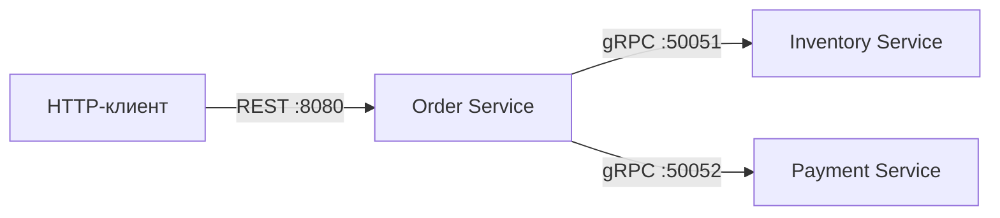
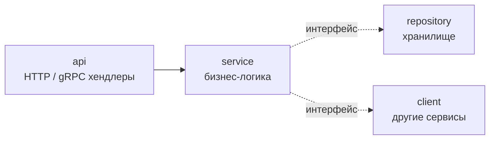

# Spaceship Factory

Микросервисная система для заказа космических кораблей на Go. Клиент собирает корабль из деталей склада (корпус, двигатель, щит, вооружение), создаёт заказ и оплачивает его.

## Архитектура

| Сервис | Протокол | Ответственность |
|---|---|---|
| **Order** | HTTP (REST) | создание, получение, оплата и отмена заказов |
| **Inventory** | gRPC | каталог деталей и остатки на складе |
| **Payment** | gRPC | проведение оплаты, выдача `transaction_uuid` |

### Слои внутри сервиса

Каждый сервис построен по Clean Architecture, зависимости направлены внутрь, к бизнес-логике:

- **api** — переводит DTO (ogen / protobuf) в доменные типы и обратно, валидирует вход;
- **service** — бизнес-правила; знает только свои модели и интерфейсы из `deps.go`;
- **repository** — хранилище, работает со своей моделью `record`;
- **client** — обёртки над gRPC-клиентами других сервисов, маппинг gRPC-кодов в доменные ошибки.

На каждом слое своя модель данных: **DTO → Input → Model → Record**, между ними явные конвертеры. Доменные ошибки (`ErrOrderNotFound`, `ErrOutOfStock`, ...) переводятся в коды протокола в одном месте: `error_handler.go` для HTTP и unary-interceptor для gRPC.

## Стек (на данный момент)

**Go 1.26** · **gRPC** · **Protocol Buffers** (buf) · **OpenAPI 3.0** (ogen) · **slog** · **testify** · **mockery** · **golangci-lint** · **Task** · **GitHub Actions**
