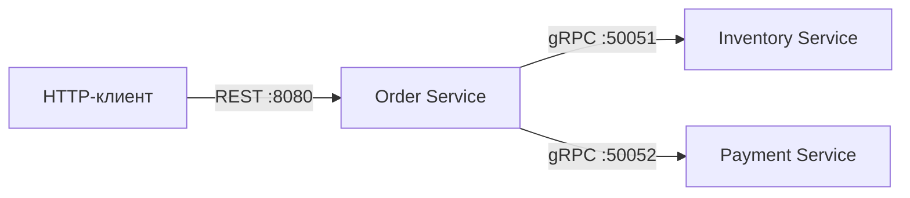
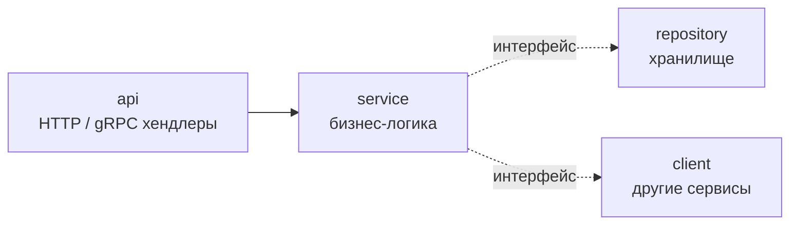

# Spaceship Factory


Микросервисная система для заказа космических кораблей на Go. Клиент собирает корабль из деталей склада (корпус, двигатель, щит, вооружение), создаёт заказ и оплачивает его.


## Архитектура



| Сервис | Протокол | Ответственность |
|---|---|---|
| **Order** | HTTP (REST) | создание, получение, оплата и отмена заказов |
| **Inventory** | gRPC | каталог деталей и остатки на складе |
| **Payment** | gRPC | проведение оплаты, выдача `transaction_uuid` |

### Слои внутри сервиса

Каждый сервис построен по Clean Architecture, зависимости направлены внутрь, к бизнес-логике:



- **api** — переводит DTO (ogen / protobuf) в доменные типы и обратно, валидирует вход;
- **service** — бизнес-правила; знает только свои модели и интерфейсы из `deps.go`;
- **repository** — хранилище, работает со своей моделью `record`;
- **client** — обёртки над gRPC-клиентами других сервисов, маппинг gRPC-кодов в доменные ошибки.

На каждом слое своя модель данных: **DTO → Input → Model → Record**, между ними явные конвертеры. Доменные ошибки (`ErrOrderNotFound`, `ErrOutOfStock`, ...) переводятся в коды протокола в одном месте: `error_handler.go` для HTTP и unary-interceptor для gRPC.

## Стек (на данный момент)

**Go 1.26** · **gRPC** · **Protocol Buffers** (buf) · **OpenAPI 3.0** (ogen) · **slog** · **testify** · **mockery** · **golangci-lint** · **Task** · **GitHub Actions**


## Запуск

Нужны Go 1.26 и [Task](https://taskfile.dev).

```bash
task setup          # установить инструменты в ./bin
task gen            # сгенерировать код из proto и OpenAPI
task deps:update    # подтянуть зависимости
```

Сервисы запускаются в отдельных терминалах:

```bash
task run:inventory  # gRPC :50051
task run:payment    # gRPC :50052
task run:order      # HTTP :8080
```

## Проверки

```bash
task format         # gofumpt + gci
task lint           # golangci-lint
task test           # unit-тесты с race-детектором
task test:api       # API-тесты всех трёх сервисов в памяти (bufconn + httptest)
task test:coverage  # покрытие бизнес-логики с порогом
```

## Что сделано

**Контракты и связь сервисов**
- [x] gRPC-контракты Inventory и Payment в Protobuf, генерация через buf
- [x] HTTP-контракт Order в OpenAPI, сервер генерируется ogen
- [x] Order вызывает Inventory и Payment по gRPC с таймаутами на каждый вызов
- [x] keepalive на серверах и клиентах, graceful shutdown всех сервисов
- [x] HTTP-сервер с таймаутами (защита от Slowloris)
- [x] маппинг gRPC-кодов в HTTP-статусы (404 / 409 / 400 / 500)

**Архитектура**
- [x] разделение на слои api / service / repository / client
- [x] интерфейсы объявляются потребителем (Dependency Inversion)
- [x] отдельные модели DTO / Input / Model / Record и конвертеры между ними
- [x] доменные ошибки и единая точка маппинга в коды протокола
- [x] архитектурный тест на правила зависимостей между слоями

**Качество**
- [x] golangci-lint с ~30 линтерами, CI на GitHub Actions
- [x] API-тесты всех сценариев: создание, оплата, отмена, ошибки валидации
- [ ] unit-тесты сервисного слоя на моках (mockery) — в процессе

## Планы

- [ ] PostgreSQL вместо in-memory хранилища, миграции
- [ ] Docker и docker-compose для запуска всей системы
- [ ] конфигурация через переменные окружения вместо хардкода портов
- [ ] валидация заказа: тип детали соответствует слоту, запрет дубликатов
- [ ] резервирование деталей на складе при создании заказа
- [ ] идемпотентность оплаты
- [ ] защита от гонок при параллельной оплате и отмене одного заказа
- [ ] аутентификация и авторизация
- [ ] observability: OpenTelemetry-трейсинг, метрики Prometheus, `trace_id` в логах